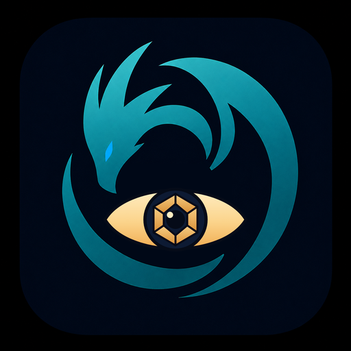
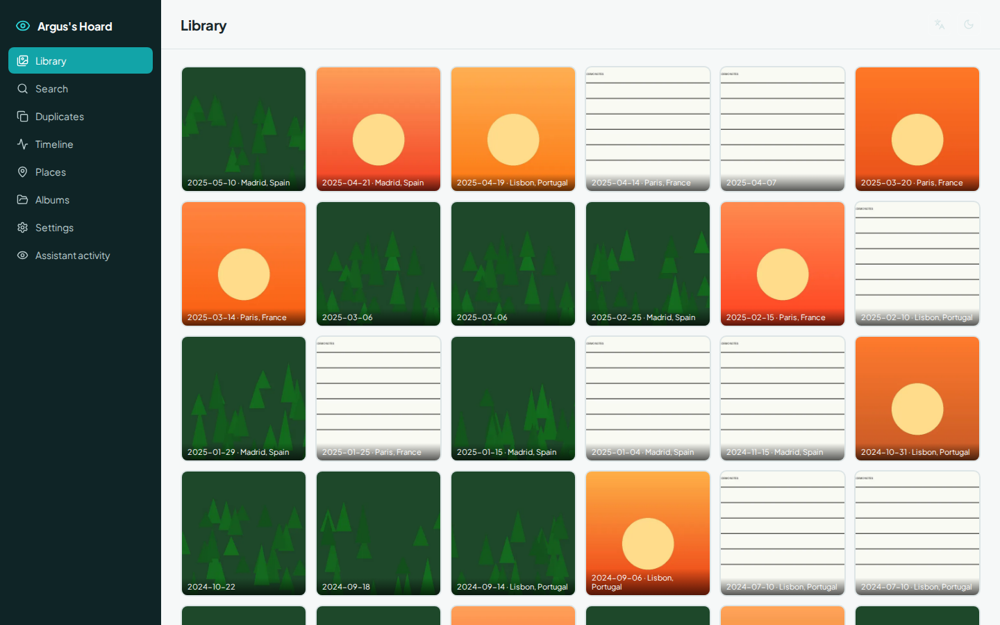
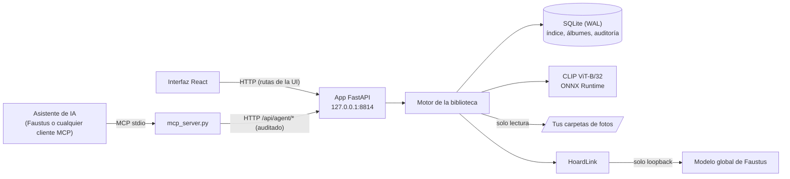
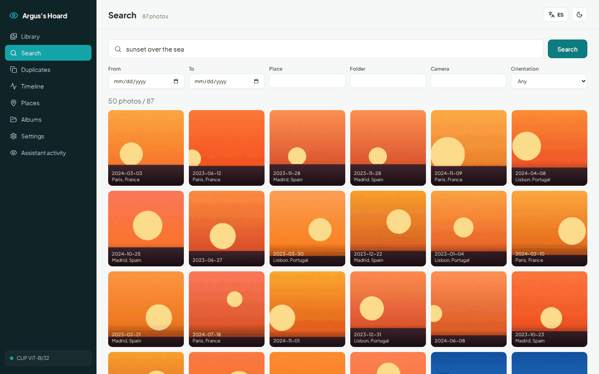
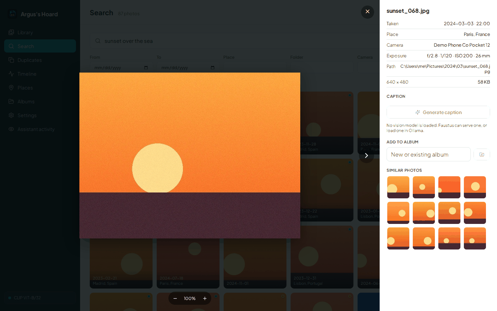
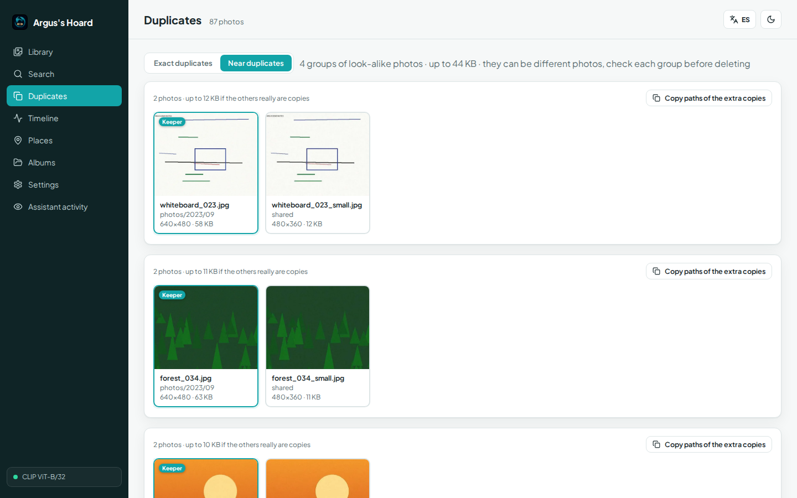
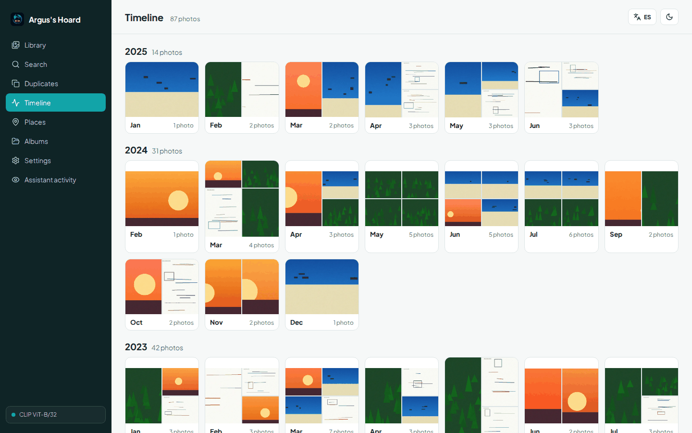
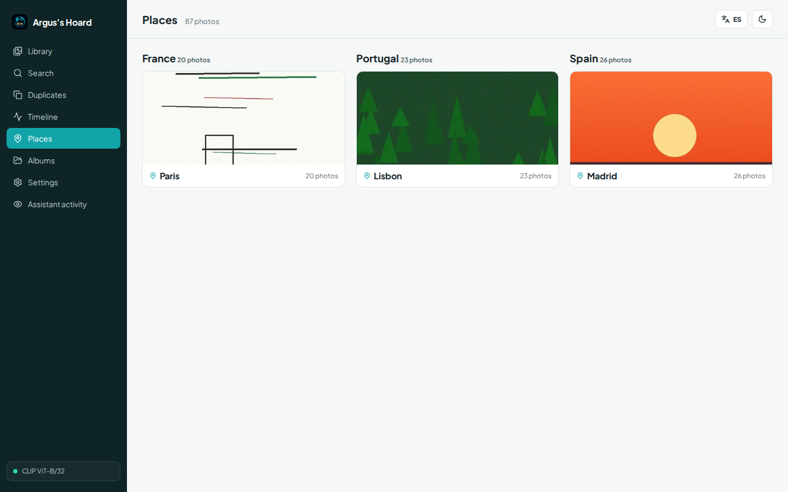
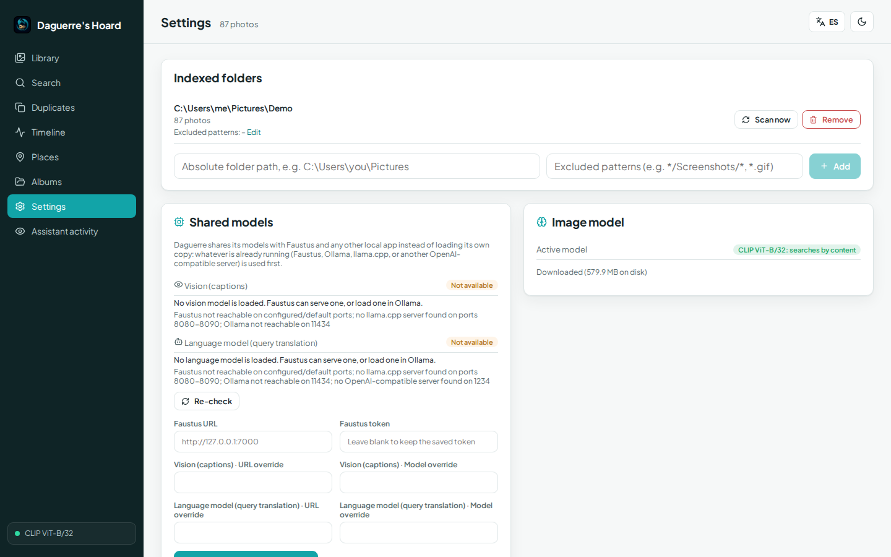

# Daguerre's Hoard

Biblioteca local de fotos con indexado, búsqueda ordenada por relevancia, detección de duplicados, edición no destructiva e ilustración vectorial, utilizable desde el navegador y desde un asistente por MCP.

[English](README.md) · [Inicio rápido](#cómo-se-ejecuta) · [Conectar con Faustus](#conectar-con-faustus-y-otros-asistentes) · [Referencia MCP](docs/MCP.md)



## Qué es

Daguerre's Hoard indexa tus carpetas de fotos y vídeos en tu propia máquina y permite buscarlas por contenido, fecha, lugar, cámara y parecido. Un modelo de lenguaje no puede revisar 20.000 fotos, así que Daguerre le da resultados cortos, filtrados y numerados, con ids estables y una banda de relevancia en cada uno; un modelo con visión puede pedir una hoja de contactos con los candidatos, y un modelo solo de texto nunca recibe una imagen que no haya pedido.

El indexado usa embeddings de imagen CLIP con ONNX Runtime (sin PyTorch, sin llamadas a la nube), lee EXIF y GPS, geocodifica sin conexión y encuentra duplicados exactos y casi idénticos. Daguerre nunca modifica, mueve ni borra un original. El único archivo que puede escribir junto a una foto es un `.xmp` opcional con tus valoraciones y tu receta de retoque, desactivado por defecto.

La misma app aloja además un estudio visual (Fotos, Capas, Revelado y un editor vectorial) cuyos módulos empiezan apagados y se activan de forma explícita.

## Qué hace

**Biblioteca e indexado**
- Escaneos incrementales en segundo plano: un archivo sin cambios cuesta un `stat`, los archivos movidos o renombrados conservan id, vector, descripción y álbumes, y un archivo ilegible se notifica sin detener el escaneo. JPEG, PNG, WebP, GIF, BMP, TIFF y HEIC/HEIF.
- Los vídeos (MP4, MOV, MKV, AVI, WebM y otros) se indexan como fotogramas clave (uno por cambio de escena más uno cada 30 s de respaldo, hasta 48 por vídeo) que pasan por el mismo proceso que las fotos; los ids de fotograma sirven allí donde sirve el id de una foto.
- Fecha EXIF con desfase horario, cámara, objetivo, exposición, ISO, distancia focal, orientación y GPS; la fecha del archivo se usa como respaldo marcado.
- Cuadrícula de miniaturas con desplazamiento infinito, visor con zoom y desplazamiento sobre una vista previa grande, panel EXIF, tira de fotos similares, temas claro y oscuro, inglés y español.

**Búsqueda**
- Texto a imagen con CLIP ViT-B/32 (las consultas en inglés funcionan mejor; las herramientas del asistente traducen), fotos similares y filtros por rango de fechas, año, mes, lugar, carpeta, cámara, orientación, megapíxeles y GPS. Las descripciones, cuando existen, se combinan en una búsqueda híbrida.
- Con la descripción vacía se usan solo los filtros y se devuelve el listado cronológico.
- El visor recorre por páginas las fotos similares ya indexadas con sus bandas de relevancia.
- Comparar dos fotos lado a lado (A/B) y exportar una selección de hasta 20 fotos como galería HTML independiente, hoja de contactos JPEG numerada y manifiesto JSON.
- Hasta que se descarga el modelo de imagen (unos 600 MB) desde Ajustes, la búsqueda recurre solo al color y lo indica.

**Duplicados, lugares y tiempo**
- Duplicados exactos (BLAKE2b) y casi idénticos (hash perceptual) con la copia sugerida para conservar y el espacio que ocupan las copias sobrantes. Solo lectura: copia las rutas de las copias o abre la carpeta; borrar es cosa tuya.
- Geocodificación inversa sin conexión (tabla de ciudades incluida, o GeoNames `cities1000` si lo pides), países y ciudades con recuento de fotos, línea temporal por año y mes y «un día como hoy». Sin teselas de mapa y sin peticiones de red.

**Álbumes, valoraciones y ediciones**
- Álbumes creados por ti o por el asistente (el asistente solo puede añadir); añadir una selección a un álbum en un paso.
- Por foto: de 0 a 5 estrellas o rechazada, etiqueta, palabras clave y una pequeña receta de revelado no destructiva (exposición, contraste, altas luces, sombras, blancos, negros, claridad, intensidad, saturación, eliminación de neblina, balance de blancos, recorte, orientación), guardada en Daguerre y, si se activa, mantenida como archivo `.xmp` estándar. Los archivos existentes y el XMP incrustado se leen en cada escaneo; los archivos se fusionan y se respaldan, nunca se reemplazan, y la activación solo puede hacerse desde Ajustes. Detalles en [Archivos .xmp](#valoraciones-recetas-de-retoque-y-archivos-xmp).
- Descripciones por foto o en lote en segundo plano con el modelo de visión global de Faustus, guardadas en un índice de texto completo. Desactivadas por defecto y nunca generadas durante el indexado.
- Igualar exposición y color a una foto de referencia y exportar copias PNG; exportar un intervalo de un vídeo como MP4 independiente (requiere FFmpeg).

**Estudio visual**
- Fotos, Capas, Revelado y un editor vectorial completo bajo `/vector/`. Una foto puede enviarse a un documento vectorial editable, se conservan las revisiones y un PNG puede exportarse de vuelta a la biblioteca. Los proyectos conservan figuras de diagrama (`.vfigure`) y los paquetes de Compositor con un subconjunto ráster verificado pueden importarse como documentos por capas.
- Los módulos empiezan APAGADOS; descubrirlos no abre motores y activarlos no escanea carpetas. Véanse el [manual del estudio](docs/STUDIO930.md), los [motores de imagen por capas](docs/CRAFT-ENGINES.es.md) y las [conexiones nativas](docs/NATIVE-CONNECTIONS.md).

**Actividad del asistente**
- Cada llamada de un asistente queda registrada en «Actividad del asistente» (herramienta, argumentos, duración, resultado o error); los clics de la propia interfaz se guardan aparte.

## Cómo se ejecuta

Requiere Python 3.11 o posterior y Node.js 22 (solo para compilar la interfaz una vez). El modelo de imagen no se incluye: Ajustes -> Modelo de imagen lo descarga cuando lo pides.

Windows (PowerShell):

```powershell
git clone https://github.com/Luissalet/DaguerresHoard.git
cd DaguerresHoard
.\scripts\start.ps1 -Demo      # primera vez: crea .venv, instala el lock, compila la interfaz y abre el navegador
```

O haz doble clic en **`Iniciar Daguerre.cmd`** (y en **`Detener Daguerre.cmd`** para pararlo). Otras opciones del lanzador: `.\scripts\start.ps1` para tu propia biblioteca en `data\`, `-Port 8820 -NoBrowser` y `.\scripts\stop.ps1`. Los registros van a `data\logs\`.

Linux / macOS:

```bash
python3 -m venv .venv
.venv/bin/python -m pip install -r requirements-lock.txt
.venv/bin/python scripts/build_studio_assets.py
.venv/bin/python scripts/build_engines.py
.venv/bin/python daguerre_hoard/studio_native/durer/scripts/build_engine.py
.venv/bin/python -m daguerre_hoard --demo --no-browser   # biblioteca sintética en data-demo/
```

Después abre <http://127.0.0.1:8814>. Opciones: `--port`, `--data-dir` (o `DAGUERRE_DATA_DIR`), `--demo`, `--no-browser`. Todo lo que escribe Daguerre vive en la carpeta de datos (`data/`, o `data-demo/` con `--demo`): base de datos, miniaturas, vectores, caché del modelo y registros. `DAGUERRE_ALLOWED_HOSTS` abre un nombre de red local o de tailnet.

## Conectar con Faustus y otros asistentes

Daguerre es un plugin de [Faustus](https://github.com/Luissalet/Faustus) y se declara en `faustus-plugin.json`. Arranca la app y, en Faustus, abre **Conectores -> Apps cercanas -> Añadir**: Faustus la encuentra en `127.0.0.1:8814`, lee el manifiesto y lanza él mismo el adaptador MCP.

Sirve cualquier cliente MCP por stdio:

```json
{
  "mcpServers": {
    "daguerre": {
      "command": "C:/ruta/a/daguerres-hoard/.venv/Scripts/python.exe",
      "args": ["C:/ruta/a/daguerres-hoard/daguerre_hoard/mcp_server.py"],
      "env": { "DAGUERRE_URL": "http://127.0.0.1:8814" }
    }
  }
}
```

En Linux o macOS el intérprete es `.venv/bin/python`. Herramientas por grupos (argumentos, formas de salida, códigos de error y límites en [docs/MCP.md](docs/MCP.md)):

| Área | Herramientas |
| --- | --- |
| Búsqueda y visualización | `photos_search`, `photos_similar`, `photos_show` (hasta 4 imágenes, 200 KB cada una), `photos_describe`, `photos_timeline`, `photos_library` |
| Duplicados | `photos_duplicates` |
| Vídeos | `videos_list`, `videos_describe`, `videos_export_clip` |
| Biblioteca y álbumes | `photos_add_folder` (solo añade), `photos_album` (solo añade), `photos_export` |
| Ediciones y archivos auxiliares | `photos_edits`, `photos_set_edits`, `photos_sidecar` |
| Estudio | Operaciones de Capas, Revelado, vectorial y proyectos, activas solo con el módulo encendido |

El agente puede añadir carpetas y álbumes pero no quitar nada, y ninguna herramienta del asistente puede activar la escritura de archivos auxiliares. La skill que indica al modelo cuándo y cómo usar las herramientas es [`skills/find-photos/SKILL.md`](skills/find-photos/SKILL.md); la app también lleva `photo-library-curation`, `image-composition`, `revision-aware-media`, `product-ui-visual-direction` y `diagram-authoring` para los agentes que se conectan.

**Modelos compartidos.** Las descripciones y la traducción de consultas usan exactamente el modelo global elegido en Faustus mediante el SDK local de la familia. Daguerre nunca elige un modelo local de respaldo ni carga un modelo de texto o visión; una selección no disponible es un error. La búsqueda de imágenes (CLIP) es siempre local. Todo lo demás funciona sin modelo de chat.

**Asistente flotante.** Con el lanzador común de Hoard Link instalado, cada página muestra el panel de Faustus. La conversación vive en Faustus; esta app informa al panel de la foto, el álbum, el vídeo o el formulario abierto (nombre de archivo en lugar de ruta, valoración, palabras clave, campos sin guardar), recarga la vista en el sitio tras cada turno y guarda solo los campos que cambiaste.

## Valoraciones, recetas de retoque y archivos .xmp

Todas las ediciones viven en la base de datos de Daguerre y la foto nunca se modifica. Se establecen en el visor (**Valoración y retoque**), con `PUT /api/photos/{id}/edits` o con `photos_set_edits`.

| Campo de la receta | Rango | Propiedad XMP |
| --- | --- | --- |
| `exposure` | -5 a +5 EV | `crs:Exposure2012` |
| `contrast`, `highlights`, `shadows`, `whites`, `blacks`, `clarity` | -100 a 100 | `crs:*2012` |
| `vibrance`, `saturation`, `dehaze` | -100 a 100 | `crs:Vibrance`, `Saturation`, `Dehaze` |
| `temperature` (K), `tint` | 2000-50000, -150 a 150 | `crs:Temperature`, `crs:Tint` |
| `crop` `{left, top, right, bottom, angle}` | bordes 0-1, ángulo -45 a 45 | `crs:Crop*`, `HasCrop` |
| `orientation` | EXIF 1-8 | `tiff:Orientation` |
| valoración, etiqueta, palabras clave | -1/0-5, texto, lista | `xmp:Rating`, `xmp:Label`, `dc:subject` |
| receta completa | | `daguerre:Recipe` (JSON), para no perder nada en un viaje de ida y vuelta |

- **La escritura es opcional** (Ajustes -> *Escribir archivos .xmp junto a las fotos editadas*, desactivada por defecto). Con ella activa, cada edición escribe también `IMG_0001.xmp` junto a `IMG_0001.jpg`; si otro archivo comparte el nombre se usa `IMG_0001.jpg.xmp`, para no mezclar nunca los ajustes de dos archivos.
- Un archivo existente se fusiona, nunca se reemplaza: solo se actualizan las propiedades anteriores y todo lo demás se conserva. Un archivo que Daguerre no escribió se copia antes a `data/xmp-backups/`. El XMP no válido se deja intacto. Las escrituras son atómicas.
- **La lectura siempre está activa**: cada escaneo lee los archivos nuevos o modificados y el XMP incrustado. Los ajustes que Daguerre no puede aplicar (curvas de tono, HSL, máscaras) se listan como «importados, no aplicados» y permanecen en el archivo.
- El XML de los archivos no es de fiar: se rechazan DOCTYPE y declaraciones de entidades y se limitan tamaño, profundidad y número de nodos.
- Daguerre solo renderiza la exposición de la receta; el resto son datos para reveladores RAW. Los formatos RAW aún no se indexan.

## Arquitectura

FastAPI y SQLite (WAL) alrededor de un motor en Python puro, una interfaz React 19 + Vite y un adaptador MCP independiente que habla con la app por HTTP. Véase [docs/ARCHITECTURE.md](docs/ARCHITECTURE.md).



| Ruta | Contenido |
| --- | --- |
| `daguerre_hoard/` | Paquete Python: API, motor de la biblioteca, escaneo, embeddings, duplicados, geocodificación, XMP, adaptador MCP, estudio |
| `frontend/` | Interfaz React 19 + Vite |
| `native/`, `daguerre_hoard/studio_native/` | Motores de imagen por capas, revelado y vectorial y editores de escritorio |
| `docs/` | Arquitectura, referencia MCP, casos de uso, manuales del estudio y de los motores |
| `skills/` | Skills para los agentes que se conectan |
| `scripts/` | Lanzadores, compiladores, demo y capturas |
| `tests/` | Suite de pytest |

## Desarrollo

```bash
.venv/bin/python -m pytest -q            # pruebas locales, sin descargas de modelos ni GPU
.venv/bin/python -m pytest -q -m model   # prueba opcional con el CLIP real
cd frontend && npm test                  # pruebas de contexto de la interfaz
```

En Windows usa `.venv\Scripts\python`. `scripts/screenshots.py` regenera las capturas desde la biblioteca de demostración.

## Privacidad y seguridad

- Escucha solo en `127.0.0.1`. La guardia común rechaza otros encabezados `Host`, peticiones entre sitios y encuadre desde otro sitio; las rutas del asistente responden solo al token de `data/mcp-token`. Sin CORS ni telemetría.
- Las únicas peticiones a internet son las que inicias en Ajustes: el modelo CLIP desde Hugging Face y el conjunto GeoNames.
- Los originales solo se leen. Quitar una carpeta en Ajustes borra los datos propios de Daguerre sobre ella, nunca los archivos.
- Los nombres de lugares proceden de [GeoNames](https://www.geonames.org/) (CC BY 4.0) cuando se descarga el conjunto completo.

## Límites conocidos

- No hay vigilante del sistema de archivos: los reescaneos los inicias tú, el agente o una carpeta nueva.
- La búsqueda vectorial es coseno por fuerza bruta, válida hasta unas 200.000 fotos en una máquina.
- Un grupo de casi duplicados puede encadenar fotos parecidas, por eso su espacio se muestra como «hasta».
- Las bandas de relevancia y los umbrales de duplicados se ajustaron con imágenes sintéticas.
- Algunos motivos y nombres de países aún aparecen en inglés en la interfaz en español.

<details>
<summary>Pantallas</summary>








Todas capturadas de la biblioteca de demostración de imágenes generadas.
</details>

## Licencia

[MIT](LICENSE).
