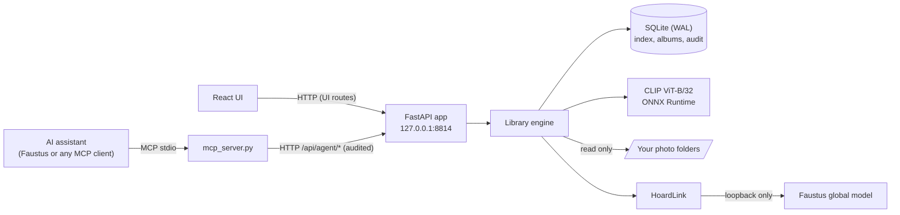

# Daguerre's Hoard

A local photo library with indexing, ranked search, duplicate finding, non-destructive editing and vector illustration, usable from a browser and from an assistant through MCP.

[Español](README.es.md) · [Quick start](#run-it) · [Connect to Faustus](#connect-to-faustus-and-other-assistants) · [MCP reference](docs/MCP.md)


## What it is

Daguerre's Hoard indexes your photo and video folders on your own machine and makes them searchable by content, date, place, camera and similarity. A language model cannot look through 20,000 photos, so Daguerre gives it short, filtered, numbered results with stable ids and a relevance band on each one; a vision model can ask for a contact sheet of candidates, and a text-only model never receives an image it did not ask for.

Indexing uses CLIP image embeddings through ONNX Runtime (no PyTorch, no cloud call), reads EXIF and GPS, reverse-geocodes offline and finds exact and near duplicates. Daguerre never modifies, moves or deletes an original. The only file it may write next to a photo is an optional `.xmp` sidecar with your ratings and retouch recipe, off by default.

The same app also hosts a visual studio (Photos, Layers, Develop and a vector editor) whose modules start off and are activated explicitly.

## What it does

**Library and indexing**
- Background, incremental scans: unchanged files cost one `stat`, moved or renamed files keep their id, vector, caption and albums, and an unreadable file is reported instead of stopping the scan. JPEG, PNG, WebP, GIF, BMP, TIFF and HEIC/HEIF.
- Videos (MP4, MOV, MKV, AVI, WebM and others) are indexed as key frames (one per scene change plus a fallback every 30 s, up to 48 per video) that go through the photo pipeline; frame ids work everywhere a photo id does.
- EXIF date with offset, camera, lens, exposure, ISO, focal length, orientation and GPS; file time is used as a flagged fallback.
- Thumbnail grid with infinite scroll, lightbox with zoom and pan on a large preview, EXIF panel, similar-photo strip, light and dark themes, English and Spanish.

**Search**
- Text to image with CLIP ViT-B/32 (English queries work best; the assistant tools translate), similar photos, and filters by date range, year, month, place, folder, camera, orientation, megapixels and GPS. Captions, when they exist, are combined into a hybrid search.
- An empty description uses the filters alone and returns the chronological listing.
- The photo viewer pages through already indexed similar photos with relevance bands.
- Compare two photos side by side (A/B), and export a selection of up to 20 photos as a standalone HTML gallery, numbered JPEG contact sheet and JSON manifest.
- Until the image model (about 600 MB) is downloaded from Settings, search falls back to colour only and says so.

**Duplicates, places and time**
- Exact duplicates (BLAKE2b) and near duplicates (perceptual hash) with a suggested keeper and the space the extra copies use. Read-only: copy the paths of extra copies or open the folder; deleting is up to you.
- Offline reverse geocoding (bundled city table, or GeoNames `cities1000` on request), countries and cities with photo counts, a timeline by year and month and "on this day". No map tiles, no network request.

**Albums, ratings and edits**
- Albums created by you or the assistant (the assistant can only add); add a selection to an album in one step.
- Per photo: 0-5 stars or rejected, label, keywords and a small non-destructive develop recipe (exposure, contrast, highlights, shadows, whites, blacks, clarity, vibrance, saturation, dehaze, white balance, crop, orientation), stored in Daguerre and optionally kept as a standard `.xmp` sidecar. Existing sidecars and embedded XMP are read on every scan; sidecars are merged and backed up, never replaced, and the opt-in can only be switched on from Settings. Details in [Sidecars](#ratings-retouch-recipes-and-xmp-sidecars).
- Captions per photo or as a background batch from the Faustus global vision model, stored in a full-text index. Off by default and never generated during indexing.
- Match exposure and colour to a reference photo and export PNG copies; export an interval of a video as a separate MP4 (needs FFmpeg).

**Visual studio**
- Photos, Layers, Develop and a complete vector editor under `/vector/`. A photo can be sent to an editable vector document, revisions are retained and a PNG can be exported back into the library. Projects retain diagram figures (`.vfigure`) and Compositor packages with a verified raster subset can be imported as layered documents.
- Modules start OFF; discovery opens no engines and activation scans no folders. See the [studio manual](docs/STUDIO930.md), [layered-image engines](docs/CRAFT-ENGINES.md) and [native connections](docs/NATIVE-CONNECTIONS.md).

**Assistant activity**
- Every call by an assistant is recorded under "Assistant activity" (tool, arguments, duration, result or error); the interface's own clicks are kept separate.

## Run it

Requires Python 3.11 or newer and Node.js 22 (only to build the interface once). The image model is not bundled: Settings -> Image model downloads it when you ask.

Windows (PowerShell):

```powershell
git clone https://github.com/Luissalet/DaguerresHoard.git
cd DaguerresHoard
.\scripts\start.ps1 -Demo      # first run: creates .venv, installs the lock, builds the UI, opens the browser
```

Or double-click **`Iniciar Daguerre.cmd`** (and **`Detener Daguerre.cmd`** to stop). Other launcher options: `.\scripts\start.ps1` for your own library in `data\`, `-Port 8820 -NoBrowser`, and `.\scripts\stop.ps1`. Logs go to `data\logs\`.

Linux / macOS:

```bash
python3 -m venv .venv
.venv/bin/python -m pip install -r requirements-lock.txt
.venv/bin/python scripts/build_studio_assets.py
.venv/bin/python scripts/build_engines.py
.venv/bin/python daguerre_hoard/studio_native/durer/scripts/build_engine.py
.venv/bin/python -m daguerre_hoard --demo --no-browser   # synthetic library in data-demo/
```

Then open <http://127.0.0.1:8814>. Flags: `--port`, `--data-dir` (or `DAGUERRE_DATA_DIR`), `--demo`, `--no-browser`. Everything Daguerre writes lives in the data folder (`data/`, or `data-demo/` with `--demo`): database, thumbnails, vectors, model cache and logs. `DAGUERRE_ALLOWED_HOSTS` opens a LAN or tailnet name.

## Connect to Faustus and other assistants

Daguerre is a plugin for [Faustus](https://github.com/Luissalet/Faustus) and declares itself in `faustus-plugin.json`. Start the app, then in Faustus open **Connectors -> Nearby apps -> Add**: Faustus finds it on `127.0.0.1:8814`, reads the manifest and launches the MCP adapter itself.

Any MCP client works over stdio:

```json
{
  "mcpServers": {
    "daguerre": {
      "command": "C:/path/to/daguerres-hoard/.venv/Scripts/python.exe",
      "args": ["C:/path/to/daguerres-hoard/daguerre_hoard/mcp_server.py"],
      "env": { "DAGUERRE_URL": "http://127.0.0.1:8814" }
    }
  }
}
```

On Linux or macOS the interpreter is `.venv/bin/python`. Tools by group (arguments, output shapes, error codes and limits are in [docs/MCP.md](docs/MCP.md)):

| Area | Tools |
| --- | --- |
| Search and viewing | `photos_search`, `photos_similar`, `photos_show` (up to 4 images, 200 KB each), `photos_describe`, `photos_timeline`, `photos_library` |
| Duplicates | `photos_duplicates` |
| Videos | `videos_list`, `videos_describe`, `videos_export_clip` |
| Library and albums | `photos_add_folder` (adds only), `photos_album` (adds only), `photos_export` |
| Edits and sidecars | `photos_edits`, `photos_set_edits`, `photos_sidecar` |
| Studio | Layers, Develop, vector and project operations, active only when the module is on |

The agent can add folders and albums but cannot remove anything, and no assistant tool can enable sidecar writing. The skill that tells the model when and how to use the tools is [`skills/find-photos/SKILL.md`](skills/find-photos/SKILL.md); the app also carries `photo-library-curation`, `image-composition`, `revision-aware-media`, `product-ui-visual-direction` and `diagram-authoring` for connecting agents.

**Shared models.** Captions and query translation use the exact global model selected in Faustus through the family's loopback SDK. Daguerre never chooses a local fallback or loads a text or vision model; an unavailable selection is an error. Image search itself (CLIP) is always local. Every other function works without a chat model.

**Floating assistant.** Once the shared Hoard Link launcher is installed, every page shows the Faustus panel. The conversation lives in Faustus; this app tells the panel which photo, album, video or form is open (file name rather than path, rating, keywords, unsaved fields), reloads the view in place after each turn and saves only the fields you changed.

## Ratings, retouch recipes and .xmp sidecars

All edits live in Daguerre's database and the photo is never changed. Set them in the lightbox (**Rating and retouch**), with `PUT /api/photos/{id}/edits` or with `photos_set_edits`.

| Recipe field | Range | XMP property |
| --- | --- | --- |
| `exposure` | -5 to +5 EV | `crs:Exposure2012` |
| `contrast`, `highlights`, `shadows`, `whites`, `blacks`, `clarity` | -100 to 100 | `crs:*2012` |
| `vibrance`, `saturation`, `dehaze` | -100 to 100 | `crs:Vibrance`, `Saturation`, `Dehaze` |
| `temperature` (K), `tint` | 2000-50000, -150 to 150 | `crs:Temperature`, `crs:Tint` |
| `crop` `{left, top, right, bottom, angle}` | edges 0-1, angle -45 to 45 | `crs:Crop*`, `HasCrop` |
| `orientation` | EXIF 1-8 | `tiff:Orientation` |
| rating, label, keywords | -1/0-5, text, list | `xmp:Rating`, `xmp:Label`, `dc:subject` |
| whole recipe | | `daguerre:Recipe` (JSON), so nothing is lost on a round trip |

- **Writing is opt-in** (Settings -> *Write .xmp sidecars next to edited photos*, off by default). With it on, each edit also writes `IMG_0001.xmp` next to `IMG_0001.jpg`; if another file shares the name, `IMG_0001.jpg.xmp` is used so settings of two files are never mixed.
- An existing sidecar is merged, never replaced: only the properties above are updated; everything else stays. A sidecar Daguerre did not write is copied to `data/xmp-backups/` first. Invalid XMP is left alone. Writes are atomic.
- **Reading is always on**: every scan reads new or changed sidecars and embedded XMP. Settings Daguerre cannot apply (tone curves, HSL, masks) are listed as "imported, not applied" and stay in the file.
- XML from files is untrusted: DOCTYPE and entity declarations are rejected and size, depth and node count are capped.
- Daguerre renders only the exposure of a recipe; the rest is data for RAW developers. RAW formats are not indexed yet.

## Architecture

FastAPI and SQLite (WAL) around a plain-Python engine, a React 19 + Vite interface and a standalone MCP adapter that talks to the app over HTTP. See [docs/ARCHITECTURE.md](docs/ARCHITECTURE.md).



| Path | Contents |
| --- | --- |
| `daguerre_hoard/` | Python package: API, library engine, scanning, embeddings, duplicates, geocoding, XMP, MCP adapter, studio |
| `frontend/` | React 19 + Vite interface |
| `native/`, `daguerre_hoard/studio_native/` | Layered-image, develop and vector engines and desktop editors |
| `docs/` | Architecture, MCP reference, use cases, studio and engine manuals |
| `skills/` | Skills for connecting agents |
| `scripts/` | Launchers, builders, demo and screenshot tooling |
| `tests/` | pytest suite |

## Development

```bash
.venv/bin/python -m pytest -q            # local tests, no model downloads or GPU
.venv/bin/python -m pytest -q -m model   # opt-in test with the real CLIP model
cd frontend && npm test                  # interface context tests
```

On Windows use `.venv\Scripts\python`. `scripts/screenshots.py` regenerates the screenshots from the demo library.

## Privacy and security

- Binds to `127.0.0.1` only. The shared guard rejects other `Host` headers, cross-site requests and framing from another site; the assistant routes answer only to the bearer token in `data/mcp-token`. No CORS, no telemetry.
- The only internet requests are those you start in Settings: the CLIP model from Hugging Face and the GeoNames dataset.
- Originals are only read. Removing a folder in Settings forgets Daguerre's own data about it, never the files.
- Place names come from [GeoNames](https://www.geonames.org/) (CC BY 4.0) when the full dataset is downloaded.

## Known limits

- No file-system watcher: rescans are started by you, the agent or a new folder.
- Vector search is brute-force cosine, fine to about 200,000 photos on one machine.
- A near-duplicate group can chain look-alike photos, so its space is shown as "up to".
- Relevance bands and duplicate thresholds were tuned on synthetic images.
- A few reasons and country names still appear in English in the Spanish interface.

<details>
<summary>Screens</summary>


All captured from the demo library of generated images.
</details>

## License

[MIT](LICENSE).
