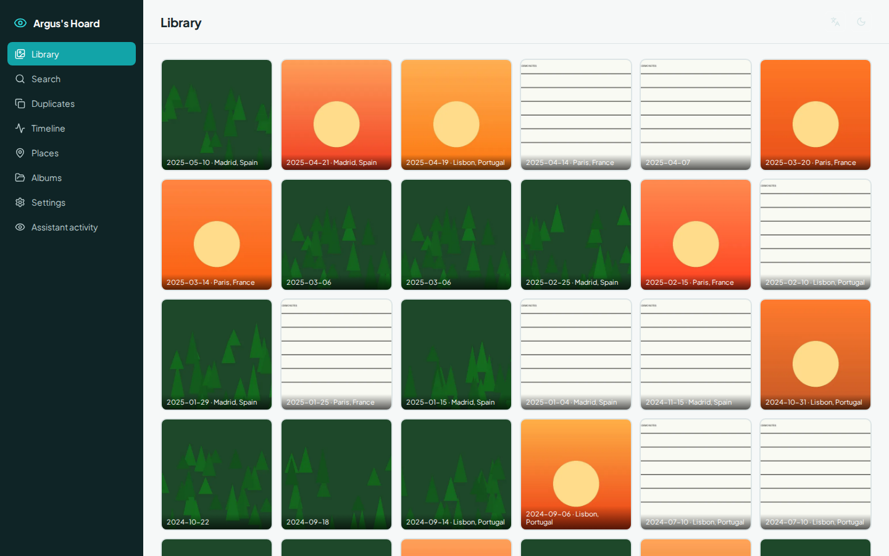
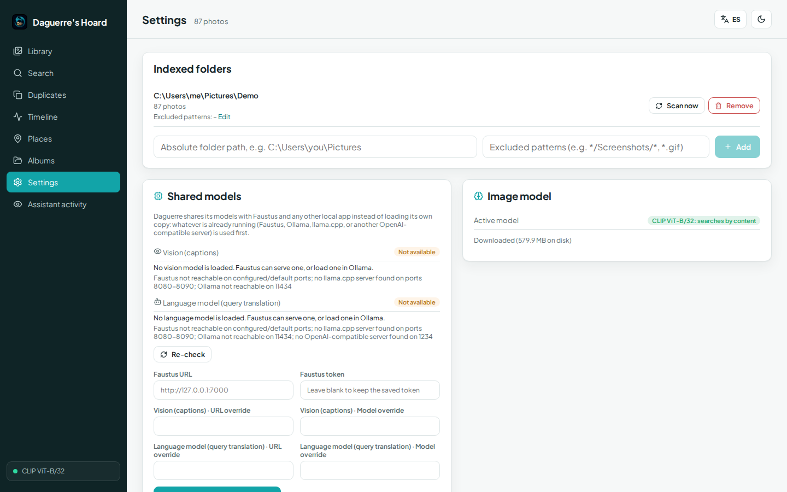
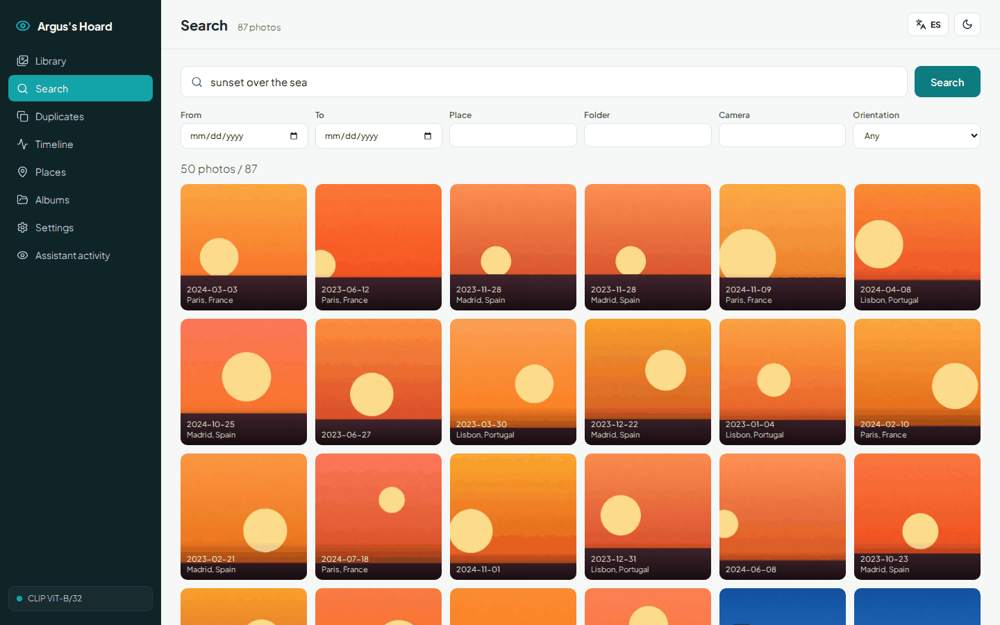
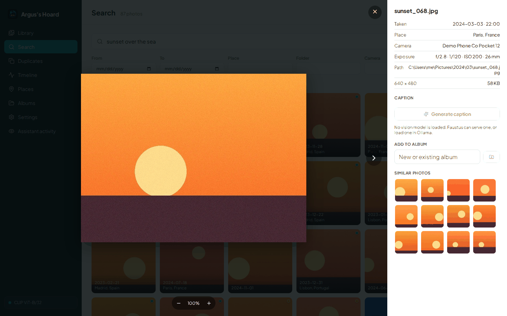
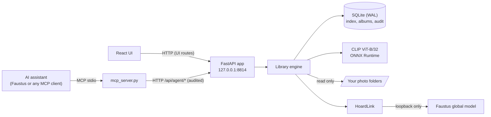
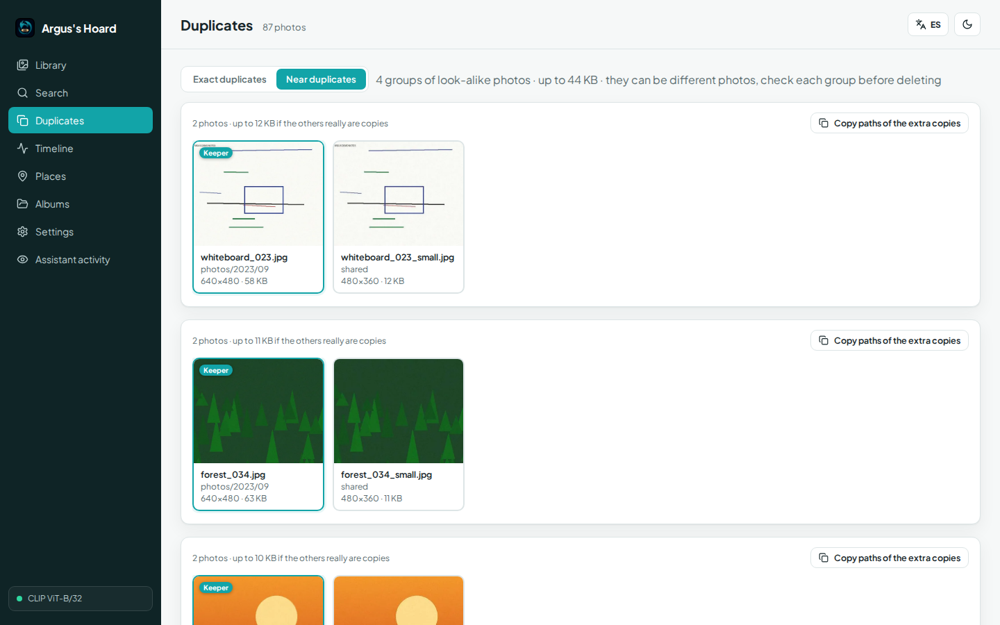
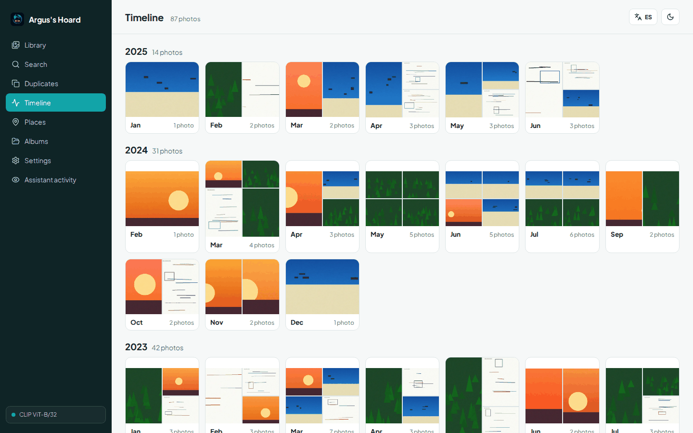

# Daguerre's Hoard

The photo viewer pages through already indexed similar photos, twelve at a time,
with names, folders, native relevance bands and index notes. The displayed total
is the number ranked by the current index, not a count of confirmed matches.
Load more keeps earlier pages on error and uses the engine's next offset. This
does not start indexing, download a model or alter original images.

In Library and Search, **Add selection to album** groups the selected loaded
photos in one action. Enter a new or suggested existing album name; matching
ignores case and accents. The receipt shows the actual album name/ID, whether it
was created, newly added relationships, total photos and unknown IDs. Existing
members are not duplicated. Selection export and A/B comparison remain available.
Photos are referenced, never copied or moved. This does not select unloaded
search results or impose the export's 20-photo limit on albums (native maximum:
500 IDs per call). Errors keep the name/selection for retry; editing the name
during a request keeps that draft while the receipt identifies the actual album.

In **Search**, leave the description blank to use the existing date, place,
folder, camera and orientation filters together. This returns the native
chronological listing without similarity scores, showing how many photos are
displayed out of the filtered total (up to 50; refine filters when more remain).
Editing criteria discards obsolete results and pending responses while keeping
the form and A/B choices. Description searches keep their existing behavior.
The existing HTTP search and `photos_search` MCP tool remain unchanged.

In a photo's rating and retouch panel, save its recipe exposure (−5 to +5 EV)
or clear only that setting. Other recipe values and metadata remain. Saving a
recipe does not render an image; the separate export control remains available.

In a photo's rating panel, **Mark as rejected** stores the native rating -1;
**Clear rejection** sets it to 0 (unrated). Neither action deletes or moves the
photo. Label/keyword drafts stay editable, and native save/sidecar receipts apply.

On narrow screens, the sidebar keeps compact navigation and a model-status
indicator. Every destination retains its translated accessible name, hover help
and current-page marker; the status indicator opens Settings. The photo workspace
fits below the Studio header so the footer remains visible.

**Compare photos** in Library and Search opens an inline A/B panel over the
currently loaded list. Select either photo by name/folder, swap A/B or open its
existing detail viewer. Desktop shows both native previews side by side; mobile
stacks them in the normal page scroll. Detail requests are independent and old
responses never replace a newly selected photo. A selection outside the current
filtered list asks for a new choice without showing unrelated metadata.
Saved dates/source, dimensions, file size and available camera/exposure metadata
remain attached to their photo. Previews do not promise original resolution or
1:1 inspection. No automatic quality ranking, original/sidecar/recipe edit or new
API/MCP tool is added. Selection export and the individual viewer stay available;
copilot receives A/B IDs/order and loaded metadata, and refresh preserves choices
that remain available. Normal library caches, thumbnails and call logs keep
their existing behavior.

The visual studio preserves Photos, Layers and Develop and incorporates the complete
vector editor under `/vector/`. Both modules start OFF; discovery opens no engines
and activation does not scan folders, recover prior jobs or attach old editor sessions.
Common projects transfer a photo into an editable vector document, retain revisions,
and export a PNG back into the photo library. See the [studio manual](docs/STUDIO930.md)
for source builds, API/MCP operations, data layout and current verification limits.
Text and vision use the configured Faustus global model; saved local model overrides
remain readable but cannot select an inference fallback.

Projects also [retain diagram figures](docs/FIGURES.md): import a complete `.vfigure`,
inspect its PNG at actual size or 2×, and download its source while modules are OFF.
Explicitly activated Vector and Layers can create native raster copies, retaining
the source document, revision and selected page/state alongside those copies.

The Windows x64 package includes all three web surfaces, assets and six native
executables. Installation uses an external profile and explicit startup; see the
manual for commands. Installed CPU checks preserve configuration/token and complete
photo→vector→PNG; actual desktop save dialogues still require visual verification.

The photo lightbox also [matches exposure and colour to a reference](docs/REFERENCE_MATCHING.md),
creating PNG copies of the current photo or a series. UI, HTTP and MCP share the
same operation and saved parameters; originals and retouch recipes stay intact.

The library, search results and albums can now [export a photo selection](docs/SELECTION_EXPORT.md)
as a standalone HTML gallery, numbered JPEG contact sheet and JSON manifest.
Select up to 20 photos, name the gallery, then open or download the actual outputs.
The UI uses the existing native `photos_export` capability; previews are up to
512 px and originals are unchanged.

*Named after Louis Daguerre, whose 1839 daguerreotype was the first practical photograph.*

A local photo library with indexing, editing, vector illustration and ranked search.

[Español](README.es.md) · [Quick start](#quick-start) · [Connect to Faustus](#connect-it-to-faustus) · [MCP reference](docs/MCP.md) · [Portfolio](https://luissalet.github.io/Portfolio/#projects)


*Actual application, synthetic demo data: 87 generated images (gradients and simple shapes, not real photos) with EXIF dates, GPS for three cities, and planted duplicates.*

## Why

A language model can read a text file, but a folder of 20,000 photos is
opaque to it: it cannot tell which one shows the whiteboard from March,
where a trip was, or that three copies of the same picture are taking up
space. Pasting images into a chat does not scale, and describing photos
from their file names invites confident guesses.

Daguerre indexes your folders on your own machine (CLIP image
embeddings through ONNX Runtime, no PyTorch, no cloud call), reads EXIF
and GPS, reverse-geocodes offline, and finds exact and near duplicates.
The model gets short, filtered, numbered results with stable ids and a
relevance band (strong/medium/weak) on each one. A vision model can ask
for a single contact-sheet image of the candidates and check ten photos
for the price of one image before it claims anything; a text-only model
never receives an image it did not ask for. Daguerre
never modifies, moves or deletes an original file; that invariant is
tested. The one file it may write next to a photo is an optional `.xmp`
sidecar with your ratings and retouch recipe, off by default (see
[Ratings, retouch recipes and .xmp sidecars](#ratings-retouch-recipes-and-xmp-sidecars)).

## Use cases

Eight scenarios, each walked in the browser and, for the agent ones, over
real MCP stdio by a script that plays a small local model
([docs/USE_CASES.md](docs/USE_CASES.md); what was found and fixed is in
[docs/USABILITY_REPORT.md](docs/USABILITY_REPORT.md)):

- **First run**: add `Pictures` (a path pasted with Explorer's quotes
  works), download the image model from Settings while the bar counts the
  megabytes, and search "sunset over the sea".
- **One photo by content and date**: *"do you still have the photo of
  the dog on the beach from last summer?"* The model searches "dog on the
  beach" with a date range, gets text only, and says how sure it is.
- **Free up space**: exact copies keep the camera-roll original, and
  "Copy paths of the extra copies" leaves the keeper out; near duplicates
  are shown as "up to", to check group by group.
- **Albums by the agent**: *"make an album 'Lisboa 2024' with the whole
  trip"*: filters alone (`place="Lisbon"`, July 2024), paged with
  `next_offset`, cover the trip.
- **With other tools**: a vertical portrait for a CV that the assistant
  then copies with its own file tools, and the clapperboard and
  green-screen shots of a short-film shoot collected in one album.
- **Memories and places**: "on this day" with places, and Places grouped
  by country and city.

## What is implemented

- **Editable Compositor import:** `.comp` directories containing a verified
  raster subset can become separate Daguerre Layers `.dglayers` pixel layers through
  `craft_import_compositor`. Includes a per-layer report, original-byte hashes,
  native save/reopen checks and PNG previews. Unsupported content blocks import
  before writing; groups, masks, adjustments and complex transforms remain gaps.
  [Configuration, supported subset and limitations](docs/CRAFT-ENGINES.md#import-a-compositor-package).

| Area | Available now | Boundary |
| --- | --- | --- |
| Indexing | Background, incremental scans: unchanged files cost one `stat`; changed files are re-read; moved or renamed files keep their id, vector, caption and albums. Parallel hashing and decoding, progress with files/s and ETA, one unreadable file is reported instead of stopping the scan. JPEG, PNG, WebP, GIF, BMP, TIFF, HEIC/HEIF | No file-system watcher: rescans are started by the user, the agent or a new folder |
| Metadata | EXIF date with time-zone offset, camera, lens, exposure, ISO, focal length, orientation, GPS; file time as fallback, flagged as such | EXIF only; XMP sidecars are not read |
| Videos | Videos in the folders (MP4, MOV, MKV, AVI, WebM, M4V, WMV, MPG, 3GP) are indexed as **key frames**: one at each scene change (ffmpeg `scene` score) plus one every 30 s as a fallback for static footage, up to 48 per video (both adjustable with `POST /api/video-settings`). Each frame goes through the photo pipeline (thumbnail, perceptual hash, CLIP embedding when the model is installed, full-text, albums) and is linked to its video with its timestamp. Videos page with a key-frame strip and a player that seeks to the clicked frame; search results show `video · 01:23`; `videos_list` and `videos_describe` tools. Incremental: a video is re-extracted only when its content changed (size/mtime, then a head+tail hash), a moved file keeps its frames, a deleted one is hidden | Needs `ffmpeg` on PATH (or `DAGUERRE_FFMPEG`); without it videos are listed with no frames and the next scan retries. Frames are stills: no audio, no speech or caption of the clip, no object tracking. The browser must support the codec for the player (frames work regardless). Frames never appear in the plain library grid, duplicates, timeline or places |
| Search | Text to image with CLIP ViT-B/32 (English queries work best; the tools tell the model to translate), similar photos, filters (date range, year, month, place, folder, camera, orientation, megapixels, GPS). Hybrid with captions when they exist | The model (about 600 MB) is downloaded only when the user clicks it in Settings. Until then a colour-only fallback is active and every result says so |
| Duplicates | Exact (BLAKE2b) and near (pHash, Hamming distance up to 6, exact multi-index lookup, union-find) with a suggested keeper (the original, not the backup or chat-app copy) and the space that extra copies use | Read-only by design: "Copy paths of the extra copies" and "Open folder", deleting is up to you. A near group can join different look-alike photos, so its space is shown as "up to" |
| Places and time | Offline reverse geocoding (bundled 10-city table, or GeoNames `cities1000` on request, where a neighbourhood is labelled with the city it belongs to: "Alfama, Lisbon, Portugal"), countries and cities with photo counts, timeline by year and month, "on this day" | No map tiles, to avoid any network request for a view. The bundled table places nothing more than 50 km from its 10 cities |
| Captions | Optional, from the configured Faustus global vision model (see below), per photo or as a background batch, stored in a full-text index for hybrid search | Off by default; never generated during indexing |
| Albums | Created by you or the agent from the lightbox or by tool call; the agent can only add | No nested albums |
| Ratings, labels, keywords, retouch recipes | Per photo: 0-5 stars (or rejected), a label, keywords and a small non-destructive develop recipe, stored in Daguerre and, if you turn it on, kept as a standard `.xmp` sidecar next to the photo; existing sidecars (and XMP embedded in JPEG/TIFF/PNG/WebP) are read on every scan. Details below | Daguerre renders only the exposure of a recipe (through Daguerre Develop); the rest is data for RAW developers. Sidecar writing is off by default |
| Interface | React desktop-style UI: thumbnail grid with infinite scroll, lightbox with zoom and pan on a large (1600 px) preview of the original, EXIF panel, similar strip, English and Spanish, light and dark | Sidebar sections are not deep-linkable URLs |
| Assistant integration | `faustus-plugin.json`, 30 MCP tools over stdio, every agent call audited in "Assistant activity" | The agent can add a folder but not remove one |
| Shared models | Captions and query translation use the exact Faustus global selection; Settings shows availability and retained legacy configuration | Image search itself (CLIP) is always local, never shared: it is not a chat model the shared backend covers |

## Shared models

Photo captions and query translation use the exact global model selected in
Faustus through an owned composition of the unchanged HoardLink SDK. Each job
pins endpoint, model and connection revision; unavailable or stale selection is an
error. Daguerre never chooses a local fallback or loads a text/vision model.
Saved legacy local URLs/model names remain readable for continuity. Other photo
functions and vector editing work without a chat model. See the
[studio manual](docs/STUDIO930.md).


*Historical screenshot of the shared-model settings. The current studio uses only the configured Faustus global service.*

## Connect it to Faustus

Daguerre is a plugin for [Faustus](https://github.com/Luissalet/Faustus), a
local AI workspace, and declares itself with `faustus-plugin.json`. Start
the app, then in Faustus open **Connectors -> Nearby apps -> Add**. Faustus finds it on
`127.0.0.1:8814`, reads the manifest from the app's working directory and
launches the MCP adapter itself.

| Tool | What | Read-only |
| --- | --- | --- |
| `photos_search` | Text (English) -> photos with relevance bands, filters, paging; a numbered contact sheet only on request | yes |
| `photos_similar` | Photos that look like a given one | yes |
| `photos_show` | Up to 4 images for a closer look (200 KB each at most) | yes |
| `photos_describe` | EXIF, place, path; optional local caption | yes (a requested caption is saved in Daguerre's database) |
| `photos_duplicates` | Exact or near duplicate groups with a keeper | yes |
| `photos_timeline` | Counts per year and month, "on this day" | yes |
| `photos_library` | Folders, counts, active model, running jobs | yes |
| `videos_list` | Indexed videos with duration and key-frame count | yes |
| `videos_describe` | One video and its key frames with timestamps (`01:23`); frame ids work in `photos_show`, `photos_similar`, `photos_album` | yes |
| `photos_add_folder` | Register a folder and index it | adds only |
| `photos_album` | Create or extend an album | adds only |
| `photos_export` | Ordered gallery HTML, contact-sheet JPEG and source manifest | writes derived files |
| `photos_edits` | Rating, label, keywords, develop recipe and `.xmp` sidecar state of one photo (reads a changed sidecar first) | yes |
| `photos_set_edits` | Set rating, label, keywords or recipe settings; keeps the `.xmp` in step when the owner enabled sidecars | writes Daguerre's data, and the sidecar only if enabled |
| `photos_sidecar` | `read` or `write` the photo's `.xmp` now | writes Daguerre's data, and the sidecar only if enabled |

`photos_export(ids=[...], title="Summer selection")` turns up to 20 chosen photos
into a portable HTML gallery with its previews embedded, a numbered contact sheet
and `manifest.json`. Selection order and deliberate repeats are preserved;
every preview/cell maps to a stable photo ID, original path and content hash.
The files live under `data/exports/`; originals are read without modification.
The same title, ordered selection, photo bytes and exported metadata reuse the
same export. Missing/unreadable photos are listed
in `omitted`, with `complete=false`. The tool returns text and file paths, so a
text-only model can prepare the collection too. This is a preview gallery;
full-resolution originals and a flipbook reader are not packaged.

It works with any MCP client over stdio:

```json
{
  "mcpServers": {
    "daguerre": {
      "command": "C:/path/to/daguerres-hoard/.venv/Scripts/python.exe",
      "args": ["C:/path/to/daguerres-hoard/daguerre_hoard/mcp_server.py"],
      "env": { "DAGUERRE_URL": "http://127.0.0.1:8814" }
    }
  }
}
```

On Linux or macOS the interpreter is `daguerres-hoard/.venv/bin/python`.

Arguments, output shapes, error codes and limits: [docs/MCP.md](docs/MCP.md).
The skill that tells the model when and how to use the tools:
[skills/find-photos/SKILL.md](skills/find-photos/SKILL.md).


*Actual application: "sunset over the sea" with the real CLIP model on the synthetic demo images.*


*The lightbox: preview of the original, EXIF, place, captions, albums and visually similar photos.*

## Ratings, retouch recipes and .xmp sidecars

Every photo can carry a rating (-1 rejected, 0-5 stars), a label, keywords and a
**retouch recipe**: a small, non-destructive description of a develop. All of it
lives in Daguerre's database and the photo is never changed. Set it in the
lightbox (**Rating and retouch**), with `PUT /api/photos/{id}/edits` or with the
`photos_set_edits` tool; `photos_describe` and `photos_edits` show it.

| Recipe field | Range | Standard XMP property |
| --- | --- | --- |
| `exposure` | -5 to +5 EV | `crs:Exposure2012` |
| `contrast`, `highlights`, `shadows`, `whites`, `blacks`, `clarity` | -100 to 100 | `crs:Contrast2012`, `Highlights2012`, `Shadows2012`, `Whites2012`, `Blacks2012`, `Clarity2012` |
| `vibrance`, `saturation`, `dehaze` | -100 to 100 | `crs:Vibrance`, `Saturation`, `Dehaze` |
| `temperature` (K), `tint` | 2000-50000, -150 to 150 | `crs:Temperature`, `crs:Tint` (+ `crs:WhiteBalance="Custom"`) |
| `crop` `{left, top, right, bottom, angle}` | edges 0-1, angle -45 to 45 | `crs:CropLeft/Top/Right/Bottom`, `CropAngle`, `HasCrop` |
| `orientation` | EXIF 1-8 | `tiff:Orientation` |
| rating, label, keywords | -1/0-5, text, list | `xmp:Rating`, `xmp:Label`, `dc:subject` |
| the whole recipe | | `daguerre:Recipe` (JSON) and `daguerre:Version`, in Daguerre's own namespace, so nothing is lost on a round trip |

**Writing is opt-in.** Settings -> *Write .xmp sidecars next to edited photos*
(off by default; an assistant cannot turn it on). With it on, every edit also
writes `IMG_0001.xmp` next to `IMG_0001.jpg` (the RAW-developer convention; an
existing `IMG_0001.jpg.xmp` is used instead if that is the file you have). The
photo itself is never touched. An existing sidecar is **merged, never replaced**:
it is parsed, only the properties above are updated in place, and every other
namespace, field, list and unmapped develop setting stays as it was. The first
time Daguerre changes a sidecar it did not write, it copies the original to
`data/xmp-backups/`. A sidecar that is not valid XMP is left alone and the edit
is kept in Daguerre with the error. Writes are atomic (temp file + rename).

**Reading is always on.** Each scan reads a new or changed sidecar (one `stat`
per photo when nothing changed) and, the first time it sees a file with no
sidecar, the XMP embedded in the JPEG/TIFF/PNG/WebP. The sidecar's rating, label
and keywords win; its develop settings overlay the stored recipe as a starting
point (for example `crs:Exposure2012="+0.85"` becomes `exposure: 0.85`). What
Daguerre has no equivalent for (tone curves, HSL, sharpening, masks...) and any
value outside its ranges is listed as *imported, not applied* and stays in the
file. Develop settings embedded in a finished JPEG are already baked into its
pixels, so they are only listed, never turned into a recipe. If the sidecar
changed on disk, an edit or `photos_edits` reads it first, so a hand edit is not
overwritten. Removing a sidecar keeps the edits.

XML from files is untrusted: documents with a DOCTYPE or entity declarations
(entity expansion, external entities) are rejected before anything expands, and
size, depth and node count are capped. No network access is involved.

Limits: Daguerre renders only the recipe's exposure (`craft_develop_photo`);
the other settings are data for RAW developers. RAW formats (CR3, NEF, ARW,
DNG...) are not indexed by Daguerre yet, so sidecars are used for the formats it
does index. `IMG_1.jpg` and `IMG_1.png` in one folder share `IMG_1.xmp`, as in
RAW developers. Comments in a merged sidecar are dropped and its whitespace is
normalised. Extended XMP (more than 64 KB in a JPEG) is not read. Temperature
is in Kelvin, as in RAW files; the relative scale used for JPEGs is reported as
not applied.

## Faustus assistant

Once the shared Hoard Link launcher is installed, the app shows the family's Faustus panel (a floating button). The conversation, the model and the tools live in Faustus; this app only tells the panel what is open.

- **Context per view.** The panel receives the page and the objects open in it, with real ids: a `photo` (file name only, not the path; taken date, place, size, caption cut to 240 characters, video link, and rating, label and up to 20 keywords from its edits), an `album` (name, photo count, creator, ids of its first 20 photos) and a `video` (name, duration, date, frame count, size). The open album also names the project. Creation forms (`new`) give no object.
- **Unsaved fields.** The panel asks for them with the `daguerre:context-request` window event. The forms `photo-edits`, `photo-album-add`, `album-new` and `search` answer with the fields typed so far and a `dirty` flag.
- **Refresh.** When the assistant finishes a turn the open view reloads in place (`hoard:copilot-turn-end` / `window.hoardCopilot.onTurnEnd`, merged into one reload). Fields you are typing keep your value; untouched ones follow the new data.
- **Saving.** The edit form sends only the fields you changed (label as text, keywords as a list) to `PUT /api/photos/{id}/edits`, which leaves rating, label, keywords and recipe alone when they are not sent; an explicit empty value clears one. Adding to an album by name keeps what it holds, and removing photos keeps the others. No endpoint changed.
- **Tests.** `cd frontend && npm test` (`node --test copilot-context.test.mjs`) and `python -m pytest tests/test_xmp_sidecars.py`.

## Quick start

Requirements: Python 3.11 or newer and Node.js 22 (only to build the
interface once). The image model is not bundled: Settings -> Image model
downloads it (about 600 MB) when you ask; until then search works on
colours only and says so.

### Windows (PowerShell)

```powershell
git clone https://github.com/Luissalet/DaguerresHoard.git
cd DaguerresHoard
.\scripts\start.ps1 -Demo      # first run: creates .venv, installs the lock, builds the UI, opens the browser
```

Or double-click **`Iniciar Daguerre.cmd`** (and **`Detener Daguerre.cmd`** to
stop). More launcher options:

```powershell
.\scripts\start.ps1              # your own library in data\
.\scripts\start.ps1 -Port 8820 -NoBrowser
.\scripts\stop.ps1
```

`start.ps1` prefers Python 3.13 when it is installed in `C:\Python313`,
reinstalls dependencies whenever `requirements-lock.txt` changes, starts
the app hidden with the repository as working directory, waits for
`/api/health` and opens the browser. Logs go to `data\logs\`.
`stop.ps1` stops the process listening on the port after confirming it is
Daguerre.

The same steps by hand:

```powershell
python -m venv .venv
.venv\Scripts\python -m pip install -r requirements-lock.txt
.venv\Scripts\python scripts/build_studio_assets.py
.venv\Scripts\python scripts/build_engines.py
.venv\Scripts\python daguerre_hoard/studio_native/durer/scripts/build_engine.py
.venv\Scripts\python -m daguerre_hoard --demo     # synthetic library in data-demo\
.venv\Scripts\python -m daguerre_hoard            # your own library, http://127.0.0.1:8814
```

### Linux / macOS

```bash
git clone https://github.com/Luissalet/DaguerresHoard.git
cd DaguerresHoard
python3 -m venv .venv
.venv/bin/python -m pip install -r requirements-lock.txt
.venv/bin/python scripts/build_studio_assets.py
.venv/bin/python scripts/build_engines.py
.venv/bin/python daguerre_hoard/studio_native/durer/scripts/build_engine.py
.venv/bin/python -m daguerre_hoard --demo --no-browser   # synthetic library in data-demo/
curl http://127.0.0.1:8814/api/health                 # {"service":"daguerres-hoard",...}
```

Then open <http://127.0.0.1:8814>. Flags: `--port`, `--data-dir` (or
`DAGUERRE_DATA_DIR`), `--demo`, `--no-browser`. Everything Daguerre writes lives
in the data folder (`data/` by default, `data-demo/` with `--demo`):
database, thumbnails, vectors, model cache, logs.

## Architecture

FastAPI and SQLite (WAL) around a plain-Python engine, a React 19 + Vite
interface, and a standalone MCP adapter that talks to the app over HTTP.
Modules, data model, the indexing pipeline, threads and the duplicate
index are described in [docs/ARCHITECTURE.md](docs/ARCHITECTURE.md).




*Near duplicates in the demo library: each planted downscaled copy is grouped with its original, keeper first.*


*Timeline: months with sample thumbnails; a month opens its photos.*

## Development

```bash
.venv/bin/python -m pytest -q            # local tests, no model downloads or GPU
.venv/bin/python -m pytest -q -m model   # 1 opt-in test with the real CLIP model (downloads it if missing)
.venv/bin/python scripts/build_studio_assets.py
.venv/bin/python scripts/build_engines.py
.venv/bin/python daguerre_hoard/studio_native/durer/scripts/build_engine.py # TypeScript strict
```

(On Windows: `.venv\Scripts\python -m pytest -q`.)

The default suite covers: originals untouched after indexing, duplicates
and album work; incremental rescans; moved files keeping their id;
corrupt files not stopping a scan; serialised concurrent scans; the data
folder never indexed as photos; re-embedding after an embedder change;
EXIF as cameras write it (sub-IFD, tuples, zeroed dates) and GPS signs;
thumbnail orientation; every supported format including HEIC; the
near-duplicate index against brute force on 8,000 hashes; union-find and
the keeper rule; contact-sheet and `photos_show` size caps;
fallback-embedder ranking and its determinism across processes; the
vector store; reverse geocoding on a fixture, including parent cities
from real GeoNames rows; filter validation, paging and an empty result
naming the filter to relax; the HTTP guard, path traversal attempts and
error shapes; the manifest; the MCP adapter spawned over stdio against a
live app (tool list, annotations, contact-sheet image, `photos_show`,
albums, errors, and the message when the app is down); and the shared
model backend (overrides that never return the Faustus token, captions
through a mocked server, a caption batch that yields to and postpones for
a busy model, a broken `backend.json`, and query translation only on the
UI route). The model test indexes the demo scenes with real CLIP and
checks that four English descriptions find the right scene.

CI (`.github/workflows/ci.yml`) runs the suite on Ubuntu and Windows with
Python 3.11, 3.12 and 3.13, builds the UI with Node 22, and drives
`start.ps1`/`stop.ps1` on Windows.

## Privacy and security

- Binds to `127.0.0.1` only; the shared Hoard Link guard rejects another `Host` header (DNS rebinding;
  `DAGUERRE_ALLOWED_HOSTS` opens a LAN name or a tailnet), cross-site requests that are not top-level navigations
  and framing from another site, and the assistant's `/api/agent/<tool>` routes answer only to the bearer token in
  `data/mcp-token`. No CORS, no telemetry.
- The only internet requests are the ones you start in Settings: the CLIP
  model from Hugging Face and the GeoNames dataset. Captions and query
  translation use the configured Faustus family service; provider credentials stay there.
- Every assistant call is recorded under **Assistant activity** (tool,
  arguments, duration, result or error); the interface's own clicks use
  separate routes and are not mixed in.
- Originals are only read. The one file written outside `data/` is the optional
  `<photo name>.xmp` sidecar, only while *Write .xmp sidecars* is on (off by
  default), merged and backed up as described above. Removing a folder in Settings forgets Daguerre's
  own data about it (index rows, thumbnails, album entries), never the
  files. The agent can add folders and albums but not remove anything.
- Place names come from [GeoNames](https://www.geonames.org/) (CC BY 4.0)
  when the full dataset is downloaded.

## Known limits and roadmap

- No file-system watcher: rescans are started by you, the agent or a new
  folder.
- Vector search is brute-force cosine: fine to about 200,000 photos on one
  machine; an ANN index can sit behind the same interface later.
- A near-duplicate group can chain different look-alike photos, which is
  why its space is shown as "up to"; a tighter grouping (bounded group
  diameter, a CLIP check) needs validating on real photos first.
- Byte-identical copies can still appear side by side in search results
  and albums.
- There is no first-run checklist yet: an amber banner and the Settings
  badge point to the image model download.
- A few reasons and country names still appear in English in the Spanish
  interface.
- CLIP relevance bands and near-duplicate thresholds were tuned on
  synthetic images; they need a check on large real libraries.

Design notes from the use-case walkthroughs: [docs/USE_CASES.md](docs/USE_CASES.md),
[docs/USABILITY_REPORT.md](docs/USABILITY_REPORT.md).

## License

[MIT](LICENSE).

## Incorporated image engines

Daguerre contains complete layered-image and development engines and desktop editors, built from detached source with own names and formats. The photo lightbox creates copies, develops them, exports results and opens the full editor. Thirty public MCP tools preserve all22 previous names; historical projects remain importable and originals untouched. See [the engine guide](docs/CRAFT-ENGINES.md) for builds, formats, provenance and verified scope.


## Native connections

Former MCP and Hub identities can use the incorporated cold compatibility adapters without the retired repositories. See [native connections](docs/NATIVE-CONNECTIONS.md). Modules still require explicit activation.
